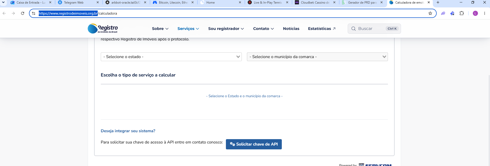

# Conversa com o Claude — projeto Due Diligence

Exportação da sessão do Claude Code de 10–11/11/2026. Mostra as mensagens do usuário, as respostas do Claude
e, resumidas em uma linha, as ferramentas que ele usou. Pensamentos internos, saídas de ferramentas e
lembretes automáticos do sistema foram omitidos. O texto colado do PRD está completo na primeira mensagem.

---

## 👤 Usuário

@"C:\Users\PC\Downloads\31082026_-_VF_Parecer_Due_Diligence_AME_Tettu - ass.pdf" @"C:\Users\PC\Downloads\CHECK LIST AME - DUE DILIGENCE - COTAS SOCIAIS - TETTU 27082026.pdf"

<pasted_content id="8dd5">
# PRD: Due Diligência

> Documento de requisitos do produto, gerado em 10/11/2026 para uso no Claude e no Claude Code.

## 1. CONTEXTO E PROBLEMA

A dor é a necessidade de uma investigação que deve ser realizada antes de fechar um negócio para conferir informações e identificar riscos.

O corretor de imóvel e ou advogado novo precisam de uma ferramenta para primeiro apresentar um relatório preliminar sobre determinado negócio, apresentado dados das partes e do bem.

## 2. SOLUÇÃO PROPOSTA

Criação de um produto para realizar due diligence: realizar as diligências necessárias para a realização do negócio.
Por exemplo, antes de comprar uma empresa, o interessado pode analisar:
- Finanças: receitas, despesas, dívidas e resultados.
- Questões jurídicas: contratos, processos e obrigações.
- Tributos: impostos pagos e possíveis pendências.
- Operação: estrutura, funcionários, clientes e fornecedores.
O objetivo é entender o que está sendo comprado, avaliar se o preço faz sentido e evitar surpresas. O resultado pode levar à negociação de um desconto, à exigência de garantias ou à desistência do negócio.

Para isso ele deve consultar certidões e informações oficiais. Todas as informações devem ser emitidas de fontes oficiais.  

Vamos fazer a consulta de certidão no site https://www.registrodeimoveis.org.br/, via API.

Primeiro vai apresentar um relatório preliminar sobre a viabilidade do negócio jurírido, considerando o bem e as partes e suas circunstâncias.

## 3. REQUISITOS FUNCIONAIS

Não informado.

## 4. PERSONAS E TIPOS DE USUÁRIO

Não informado.

## 5. STACK TECNOLÓGICA

- Supabase
- Vercel

## 6. LINGUAGEM DE DESIGN

Não informado.

## 7. PROCESSO DE DESENVOLVIMENTO

- Divida a construção em etapas lógicas (milestones)
- Cada etapa deve entregar um incremento funcional e testável
- Priorize as funcionalidades principais primeiro e depois itere
- Teste cada etapa antes de passar para a próxima
- Antes de começar, liste as dúvidas e as suposições sobre este PRD

## 8. INSTRUÇÕES PARA O CLAUDE

- Leia o PRD inteiro antes de escrever código
- Se faltar informação essencial, pergunte antes de supor
- Proponha a estrutura de pastas e o modelo de dados antes da primeira etapa
- Mantenha o código simples, tipado e documentado
- Ao fim de cada etapa, resuma o que foi feito e o que vem a seguir

---
> Gerado pelo Gerador de PRD Tech4You (solucoes4you.com.br), otimizado para Claude e Claude Code
</pasted_content id="8dd5">

<details><summary>Ferramentas usadas (6)</summary>

- `plano` — Ler os dois PDFs de referência; Ver a pasta Due Diligente; Verificar API do registrodeimoveis.org.br; Apresentar dúvidas, estrutura e modelo de dados
- `Read` — C:\Users\PC\Downloads\31082026_-_VF_Parecer_Due_Diligence_AME_Tettu - ass.pdf
- `Read` — C:\Users\PC\Downloads\CHECK LIST AME - DUE DILIGENCE - COTAS SOCIAIS - TETTU 27082026.pdf
- `PowerShell` — List the Due Diligente folder
- `Read` — C:\Users\PC\Desktop\Due Diligente\RESUMO - Juridico Redeplan (TETTU x Redeplan x M&K).pdf
- `Read` — C:\Users\PC\Desktop\Due Diligente\Status do canal Juridico Redeplan.txt

</details>

## 🤖 Claude

Now checking whether registrodeimoveis.org.br offers an API.

<details><summary>Ferramentas usadas (4)</summary>

- `ToolSearch`
- `WebSearch` — registrodeimoveis.org.br API ONR certidão de matrícula integração empresas
- `WebSearch` — ONR SAEC API pedido certidão matrícula online parceiros integração webservice
- `resumo da etapa` — Li o PRD, o checklist e o parecer da AME (Tettu), a pasta Due Diligente e pesquisei a API do registrodeimoveis.org.br. Nenhum código foi escrito ainda. A proposta de estrutura, modelo de dados e etapas aguarda as suas respostas.

</details>

## 🤖 Claude

Li o PRD, os dois PDFs da AME e a pasta `Due Diligente`. Como o PRD pede, antes de escrever código seguem as dúvidas, as suposições, a estrutura de pastas, o modelo de dados e as etapas.

## Um achado que muda o plano: a API do registrodeimoveis.org.br

O PRD diz para consultar certidões "via API" no registrodeimoveis.org.br. Na pesquisa não achei **nenhuma API pública e aberta** do portal. O que existe:

- **SAEC/ONR**: tem web services (WS Ofício, certidão digital automática), mas são de uso dos cartórios ou de parceiros credenciados. A documentação pública que achei é antiga ([especificação WS SAEC](https://ridigital.org.br/downloads/Especificacao_wssaec_dev.pdf), [manual da Certidão Digital](https://registradores.onr.org.br/Downloads/SAEC_CertidaoDigital.pdf)). Para usar, provavelmente é preciso um convênio com o [ONR](https://onr.org.br). Isso é dedução minha, não está confirmado.
- **Intermediários pagos**, como a [Infosimples](https://infosimples.com/consultas/registradores-certid-pedido/). Eles automatizam o portal e usam o seu saldo lá. Não é API oficial, mas o documento que chega é a certidão oficial.
- **Toda certidão tem custo** (os emolumentos do cartório). A "matrícula online" é só para informação e **não vale como certidão** ([fonte](https://jornalcontabil.com.br/noticia/cartorios-de-imoveis-lancam-plataforma-nacional-de-servicos-online/amp/)).
- Boa parte das outras certidões do checklist (Receita/PGFN, CNDT do TST, TJ-RJ, TRF-2, TRT-1) tem captcha e nenhuma API gratuita. O produto não vai burlar captcha. Os caminhos são um provedor pago ou o usuário enviar o PDF.

**Minha proposta:** o MVP trabalha com **upload das certidões** que o usuário já tirou. Tudo passa por uma camada de "provedores de certidão", e a integração com o ONR ou a Infosimples entra numa etapa posterior, sem reescrever nada.

## Dúvidas (preciso das respostas)

1. **Tipo de negócio do MVP:** compra e venda de **imóvel** (corretor: matrícula, ônus, partes) ou **empresa/trespasse** (como no caso da AME)? Eu começaria pelo imóvel, que é o foco do PRD e da equipe de vendas da Redeplan. O checklist da AME entraria como um segundo modelo.
2. **Certidões:** você aceita o MVP com upload e integração depois? Se sim, pretende pedir convênio ao ONR ou usar um provedor pago?
3. **Análise com IA:** posso usar o Claude para ler as certidões (positiva ou negativa, data, validade, ônus da matrícula) e redigir o relatório preliminar? O relatório sairia sempre como **rascunho para um advogado revisar**.
4. **Usuários:** uso interno da TETTU/M&K ou um produto vendido a vários escritórios e imobiliárias (multi-tenant, cobrança)? E quem paga os emolumentos?
5. **Identidade visual:** usar o padrão TETTU (Calibri, marinho e roxo) ou uma marca própria do produto?
6. **Local:** posso criar o projeto em `C:\Users\PC\Desktop\Due Diligente\app`, num repositório Git próprio e separado do Bot Crypto?

## Suposições (se você não disser o contrário)

- Next.js (App Router) + TypeScript + Tailwind na Vercel. Supabase para banco, login, armazenamento dos PDFs e regras de acesso (RLS) por organização.
- Dados no Supabase em região do Brasil (São Paulo), por causa da LGPD: CPF, estado civil e documentos pessoais.
- Os status dos itens seguem o padrão do parecer: **COMPLETO / PARCIAL / FALTANTE**, mais "vencido" quando a certidão passa da validade.
- O relatório segue o formato do parecer da AME: resumo executivo, tabela por eixo, documentos fora do checklist e parecer final (viável, viável com ressalvas, incompleto ou inviável).

## Estrutura de pastas

```
app/
  src/app/(auth)/            login
  src/app/negocios/          lista, novo, [id]: partes, bens, checklist, documentos, relatório
  src/lib/supabase/          clientes server/browser
  src/lib/checklist/         motor de status e validade
  src/lib/providers/         interface CertidaoProvider: upload, onr, infosimples
  src/lib/analysis/          extração por IA e geração do relatório
  src/lib/report/            PDF do relatório
  supabase/migrations/       SQL + RLS
  supabase/seed/             modelos de checklist (imóvel; cotas/trespasse = TETTU)
  tests/
```

## Modelo de dados (resumo)

| Tabela | Conteúdo principal |
|---|---|
| `organizations`, `members` | escritório/imobiliária, usuários e papéis (corretor, advogado, admin) |
| `deals` | negócio: tipo, status, valor, responsável |
| `parties` | partes: PF/PJ, CPF/CNPJ, papel (vendedor, comprador, cônjuge, sócio), estado civil, regime de bens |
| `assets` | bem: imóvel (matrícula, cartório/CNS, município, inscrição de IPTU) ou empresa (CNPJ) |
| `checklist_templates`, `template_items` | modelos com código (SOC-01, JUD-02…), eixo, regra de validade, se vale para parte ou bem |
| `deal_items` | item do checklist por negócio/parte/bem: status, observação |
| `documents` | PDF no Storage, tipo, emissor, data de emissão, validade, resultado, origem (upload/api), hash |
| `certificate_requests` | pedidos a provedores: protocolo, status, custo |
| `findings` | riscos: eixo, gravidade (crítico, alto, médio), texto, item ligado |
| `reports` | versões do relatório: rascunho, revisado, assinado, PDF |
| `audit_log` | quem fez o quê e quando |

## Etapas

- **M0:** repositório, Next.js + Supabase, login, organizações, RLS. Deploy na Vercel.
- **M1:** cadastro de negócio, partes e bens. Modelos de checklist gerando os itens.
- **M2:** upload de documentos ligados aos itens, status manual e controle de validade.
- **M3:** a IA lê cada certidão, sugere o status e aponta riscos; o usuário confirma.
- **M4:** relatório preliminar em PDF, no formato do parecer da AME.
- **M5:** integrações de certidão (ONR ou provedor), começando pela matrícula.

Cada etapa termina com testes passando e um resumo do que vem a seguir.

---

## 👤 Usuário

Sim, siga

<details><summary>Ferramentas usadas (3)</summary>

- `plano` — Conferir ferramentas instaladas no PC; Criar o app Next.js em Due Diligente\app; Escrever migração Supabase com organizações e RLS; Implementar login e proteção de rotas; Testes, lint e build; Documentar setup e próximos passos
- `PowerShell` — Check node, npm, git, supabase, docker versions
- `PowerShell` — Scaffold Next.js app in Due Diligente folder

</details>

---

## 👤 Usuário

*(enviada durante o trabalho)*



<details><summary>Ferramentas usadas (8)</summary>

- `WebFetch` — https://www.registrodeimoveis.org.br/calculadora
- `PowerShell` — Inspect scaffolded app
- `PowerShell` — Install Supabase, zod, vitest, pglite
- `PowerShell` — Show dependency conflict and AGENTS.md
- `PowerShell` — Install test deps with Node 24 types; find docs
- `Read` — C:\Users\PC\Desktop\Due Diligente\app\node_modules\next\dist\docs\01-app\01-getting-started\16-proxy.md
- `resolve-library-id`
- `query-docs`

</details>

## 🤖 Claude

Estou montando a M0: o app Next.js 16 já está criado e com as dependências instaladas. Agora escrevo a migração do banco (organizações, membros e RLS) e o login.

<details><summary>Ferramentas usadas (7)</summary>

- `Bash` — Create folders and read scaffold files
- `Write` — C:\Users\PC\Desktop\Due Diligente\app\supabase\migrations\20261111000000_m0_organizacoes.sql
- `Write` — C:\Users\PC\Desktop\Due Diligente\app\tests\db\harness.ts
- `Write` — C:\Users\PC\Desktop\Due Diligente\app\tests\db\rls-organizacoes.test.ts
- `Write` — C:\Users\PC\Desktop\Due Diligente\app\vitest.config.ts
- `PowerShell` — Run RLS tests
- `PowerShell` — Rename vitest config; check proxy runtime docs

</details>

## 🤖 Claude

Now the auth and app code.

<details><summary>Ferramentas usadas (23)</summary>

- `Write` — C:\Users\PC\Desktop\Due Diligente\app\src\lib\env.ts
- `Write` — C:\Users\PC\Desktop\Due Diligente\app\src\lib\supabase\server.ts
- `Write` — C:\Users\PC\Desktop\Due Diligente\app\src\lib\supabase\proxy.ts
- `Write` — C:\Users\PC\Desktop\Due Diligente\app\src\lib\routes.ts
- `Write` — C:\Users\PC\Desktop\Due Diligente\app\src\proxy.ts
- `Write` — C:\Users\PC\Desktop\Due Diligente\app\src\lib\validation.ts
- `Write` — C:\Users\PC\Desktop\Due Diligente\app\tests\validation.test.ts
- `Write` — C:\Users\PC\Desktop\Due Diligente\app\src\app\login\actions.ts
- `Write` — C:\Users\PC\Desktop\Due Diligente\app\src\app\login\auth-forms.tsx
- `Write` — C:\Users\PC\Desktop\Due Diligente\app\src\app\login\page.tsx
- `Write` — C:\Users\PC\Desktop\Due Diligente\app\src\app\auth\confirm\route.ts
- `Write` — C:\Users\PC\Desktop\Due Diligente\app\src\app\actions.ts
- `Write` — C:\Users\PC\Desktop\Due Diligente\app\src\app\org-form.tsx
- `Write` — C:\Users\PC\Desktop\Due Diligente\app\src\app\page.tsx
- `Write` — C:\Users\PC\Desktop\Due Diligente\app\src\app\layout.tsx
- `Write` — C:\Users\PC\Desktop\Due Diligente\app\src\app\globals.css
- `PowerShell` — Install server-only; typecheck and lint
- `PowerShell` — Add scripts; run typecheck, lint, tests
- `PowerShell` — Show package.json; run production build
- `Bash` — Wrap dynamic data in Suspense; rebuild
- `Write` — C:\Users\PC\Desktop\Due Diligente\app\.env.example
- `Bash` — Add env files and launch config
- `navegador:preview_start` — 

</details>

## 🤖 Claude

Build passou e os 23 testes estão verdes. Agora confiro no navegador se a tela de login abre e se o redirecionamento funciona.

<details><summary>Ferramentas usadas (3)</summary>

- `navegador:computer` — screenshot
- `navegador:read_console_messages` — 
- `navegador:preview_logs` — 

</details>

## 🤖 Claude

O preview abriu o painel local do ArbBot, que tinha uma configuração com a mesma porta. Paro esse servidor (é só o dev local, a produção na VM não é afetada) e uso outro nome e porta.

<details><summary>Ferramentas usadas (9)</summary>

- `navegador:preview_stop` — 
- `Bash` — Use unique launch name and port 3100
- `navegador:preview_start` — 
- `navegador:preview_stop` — 
- `Bash` — Start Due Diligence dev server on port 3100
- `navegador:browser_batch` — 
- `navegador:browser_batch` — 
- `navegador:computer` — screenshot
- `navegador:browser_batch` — 

</details>

## 🤖 Claude

Login e redirecionamento funcionando. Falta testar o envio do cadastro (sem Supabase real, tem que aparecer erro amigável).

<details><summary>Ferramentas usadas (6)</summary>

- `navegador:read_page` — 
- `navegador:browser_batch` — 
- `navegador:browser_batch` — 
- `Write` — C:\Users\PC\Desktop\Due Diligente\app\README.md
- `PowerShell` — Initialize git repo and show files
- `resumo da etapa` — A M0 está pronta em Due Diligente\app: login, organizações, papéis e RLS. Os 23 testes passam, e typecheck, lint e build também. Ainda não testei com um Supabase real, porque falta você criar o projeto. Nada foi commitado nem publicado.

</details>

## 🤖 Claude

A M0 está pronta no projeto novo, em `C:\Users\PC\Desktop\Due Diligente\app`, num repositório Git próprio e separado do Bot Crypto. Os testes, a checagem de tipos, o lint e o build passam. Ainda não rodou contra um Supabase de verdade, porque o projeto no Supabase ainda não existe.

**O que foi feito**
- **Banco** ([migração](supabase/migrations/20261111000000_m0_organizacoes.sql)):
  - Tabelas de perfis, organizações (escritório ou imobiliária) e membros, com os papéis dono, admin, advogado e corretor.
  - Cada organização só vê os próprios dados (RLS).
  - Organização só é criada pela função `create_organization`, que torna o criador dono, e nunca fica sem dono.
- **Login** por e-mail e senha, com cadastro, confirmação por e-mail e saída. Quem não está logado vai para `/login`, e cada ação confere o usuário também no servidor.
- **Tela inicial**: lista as suas organizações e tem o formulário para criar uma, com CNPJ validado.
- **Testes**: 23 no total.
  - 15 aplicam a migração real num Postgres em memória e provam o isolamento entre organizações, os papéis e a regra do último dono. Não precisa de Docker, que não está instalado no PC.
  - 8 testam as validações e a proteção contra redirecionamento para outro site.
- **No navegador**: conferi que `/` leva para `/login`, que o link de confirmação inválido mostra o aviso e que um cadastro com falha mostra uma mensagem amigável.

**O que fica com você**
1. Criar o projeto no Supabase na região de São Paulo, aplicar a migração e preencher o `.env.local`. O passo a passo está no [README](README.md).
2. Importar o repositório na Vercel quando quiser publicar.
3. Pedir a chave da API do registrodeimoveis.org.br. No pedido, pergunte se a API também faz **pedido de certidão de matrícula** ou só calcula emolumentos. Isso define a M5.

**Observações**
- O Next.js instalado é a versão 16, em que o antigo `middleware` agora se chama `proxy`. O código já segue isso.
- O Preview do app abria o painel local do ArbBot, que ocupa a porta 3000. Parei esse servidor de desenvolvimento local; a produção na VM não foi afetada. O Due Diligence roda na porta **3100**, e o servidor dele ficou ligado em segundo plano.
- Depois de um erro no cadastro, os campos do formulário são limpos, que é o comportamento padrão do React 19. Mantenho os valores na M1 se preferir.

Próxima etapa: **M1**, com negócios, partes e bens, e os modelos de checklist de imóvel e de cotas/trespasse (baseado no checklist da TETTU).

---

## 👤 Usuário

Sim, commite

<details><summary>Ferramentas usadas (6)</summary>

- `plano` — Fazer o primeiro commit da M0
- `PowerShell` — Commit M0 to the new repository
- `Bash` — Commit M0 using a heredoc message
- `Bash` — Read git identity used in Bot Crypto repo
- `Bash` — Set repo-local identity and commit M0
- `resumo da etapa` — A M0 está commitada no repositório novo em Due Diligente\app (commit 0d24a51, branch main), com a árvore limpa. Não há remoto configurado e nada foi publicado. O próximo passo é a M1.

</details>

## 🤖 Claude

A M0 está commitada: commit `0d24a51` na branch `main` do repositório novo em `Due Diligente\app`. Não ficou nenhuma alteração pendente.

- O Git do PC não tinha nome e e-mail configurados para esse repositório. Usei os mesmos do Bot Crypto (Godo Software e o seu e-mail), só neste repositório, sem mudar a configuração global.
- Não há GitHub ligado: o commit existe só no seu PC. Se quiser um repositório privado no GitHub, como no ArbBot, eu crio e envio quando você pedir.
- O `.env.local` ficou fora do commit, como deve ser.

---

## 👤 Usuário

Sim, comece a M1

## 🤖 Claude

Começando a M1: primeiro a migração com negócios, partes, bens e os modelos de checklist.

<details><summary>Ferramentas usadas (2)</summary>

- `plano` — Migração: negócios, partes, bens, checklists; Semear modelos: imóvel e cotas/trespasse TETTU; Testes de banco da geração do checklist; Validações e Server Actions; Telas de negócios, partes, bens e checklist; Verificar build, testes e navegador; commit
- `Write` — C:\Users\PC\Desktop\Due Diligente\app\supabase\migrations\20261111010000_m1_negocios.sql

</details>

---

## 👤 Usuário

*(enviada durante o trabalho)*

pode seguir os demais passos sem parar, até terminar todo o projeto.

<details><summary>Ferramentas usadas (5)</summary>

- `plano` — M1: migração, modelos e testes de banco; M1: telas de negócios, partes, bens e checklist; M2: upload de documentos, status e validade; M3: leitura das certidões por IA; M4: relatório preliminar em PDF; M5: provedores de certidão (upload, ONR, simulado); Verificar tudo no navegador e documentar
- `Write` — C:\Users\PC\Desktop\Due Diligente\app\supabase\migrations\20261111010100_m1_modelos.sql
- `Write` — C:\Users\PC\Desktop\Due Diligente\app\tests\db\negocios.test.ts
- `PowerShell` — Run all tests
- `PowerShell` — Fix org names in test; rerun

</details>

## 🤖 Claude

PowerShell 5.1 corrompeu a acentuação do arquivo ao regravar. Desfaço a dupla codificação:

<details><summary>Ferramentas usadas (12)</summary>

- `Bash` — Undo double encoding and rerun tests
- `Write` — C:\Users\PC\Desktop\Due Diligente\app\src\lib\domain.ts
- `Read` — C:\Users\PC\Desktop\Due Diligente\app\src\lib\validation.ts
- `Edit` — C:\Users\PC\Desktop\Due Diligente\app\src\lib\validation.ts
- `Edit` — C:\Users\PC\Desktop\Due Diligente\app\src\lib\validation.ts
- `Write` — C:\Users\PC\Desktop\Due Diligente\app\tests\validation-negocios.test.ts
- `PowerShell` — Run tests
- `Edit` — C:\Users\PC\Desktop\Due Diligente\app\supabase\migrations\20261111010000_m1_negocios.sql
- `Write` — C:\Users\PC\Desktop\Due Diligente\app\src\lib\db-types.ts
- `Write` — C:\Users\PC\Desktop\Due Diligente\app\src\components\ui.tsx
- `Write` — C:\Users\PC\Desktop\Due Diligente\app\src\components\app-header.tsx
- `Write` — C:\Users\PC\Desktop\Due Diligente\app\src\app\negocios\actions.ts

</details>

## 🤖 Claude

A M1 está avançando: a migração e os modelos estão prontos e os 45 testes passam. Agora vêm as telas de negócios (lista, criação e detalhe com partes, bens e checklist).

<details><summary>Ferramentas usadas (18)</summary>

- `Write` — C:\Users\PC\Desktop\Due Diligente\app\src\app\negocios\page.tsx
- `Write` — C:\Users\PC\Desktop\Due Diligente\app\src\app\negocios\progress-bar.tsx
- `Write` — C:\Users\PC\Desktop\Due Diligente\app\src\app\negocios\novo\page.tsx
- `Write` — C:\Users\PC\Desktop\Due Diligente\app\src\app\negocios\novo\new-deal-form.tsx
- `Edit` — C:\Users\PC\Desktop\Due Diligente\app\src\app\globals.css
- `Edit` — C:\Users\PC\Desktop\Due Diligente\app\src\app\globals.css
- `Edit` — C:\Users\PC\Desktop\Due Diligente\app\src\app\globals.css
- `Write` — C:\Users\PC\Desktop\Due Diligente\app\src\lib\checklist\build.ts
- `Write` — C:\Users\PC\Desktop\Due Diligente\app\tests\checklist.test.ts
- `Write` — C:\Users\PC\Desktop\Due Diligente\app\src\app\negocios\[id]\page.tsx
- `Write` — C:\Users\PC\Desktop\Due Diligente\app\src\app\negocios\[id]\deal-actions.tsx
- `Write` — C:\Users\PC\Desktop\Due Diligente\app\src\app\negocios\[id]\parties-section.tsx
- `Write` — C:\Users\PC\Desktop\Due Diligente\app\src\app\negocios\[id]\assets-section.tsx
- `Write` — C:\Users\PC\Desktop\Due Diligente\app\src\app\negocios\[id]\checklist-view.tsx
- `Bash` — Move loadDeal to lib; drop render prop; redirect login to deals
- `Read` — C:\Users\PC\Desktop\Due Diligente\app\src\app\page.tsx
- `Edit` — C:\Users\PC\Desktop\Due Diligente\app\src\app\page.tsx
- `Bash` — Fix home page; typecheck, lint, test

</details>

## 🤖 Claude

Telas da M1 escritas. Os 47 testes passam e a checagem de tipos também. Falta corrigir um aviso do lint antes de ver tudo no navegador.

<details><summary>Ferramentas usadas (2)</summary>

- `Bash` — Reset forms by remount; lint and typecheck
- `Bash` — Build and commit M1

</details>

## 🤖 Claude

M1 commitada (`cc574e7`). Agora a M2: upload de documentos para o Supabase Storage, ligação de cada documento ao item do checklist e controle de validade.

<details><summary>Ferramentas usadas (16)</summary>

- `plano` — M1: migração, modelos e testes de banco; M1: telas de negócios, partes, bens e checklist; M2: upload de documentos, status e validade; M3: leitura das certidões por IA; M4: relatório preliminar em PDF; M5: provedores de certidão (upload, ONR, simulado); Verificar tudo no navegador e documentar
- `Write` — C:\Users\PC\Desktop\Due Diligente\app\supabase\migrations\20261111020000_m2_documentos.sql
- `Edit` — C:\Users\PC\Desktop\Due Diligente\app\tests\db\harness.ts
- `Write` — C:\Users\PC\Desktop\Due Diligente\app\tests\db\documentos.test.ts
- `PowerShell` — Run tests
- `Edit` — C:\Users\PC\Desktop\Due Diligente\app\tests\db\documentos.test.ts
- `Write` — C:\Users\PC\Desktop\Due Diligente\app\src\lib\checklist\validity.ts
- `Write` — C:\Users\PC\Desktop\Due Diligente\app\tests\validity.test.ts
- `PowerShell` — Run validity tests
- `Write` — C:\Users\PC\Desktop\Due Diligente\app\src\lib\documents.ts
- `Write` — C:\Users\PC\Desktop\Due Diligente\app\tests\documents.test.ts
- `PowerShell` — Run document helper tests
- `Edit` — C:\Users\PC\Desktop\Due Diligente\app\src\lib\documents.ts
- `Edit` — C:\Users\PC\Desktop\Due Diligente\app\tests\documents.test.ts
- `PowerShell` — Rerun document helper tests
- `Bash` — Add DocumentRow type and load documents

</details>

## 🤖 Claude

M2 em andamento: banco, Storage e regras de validade estão prontos e testados. Agora ligo os documentos ao checklist e faço a tela de upload.

<details><summary>Ferramentas usadas (11)</summary>

- `Bash` — Attach documents and validity to checklist; test
- `Write` — C:\Users\PC\Desktop\Due Diligente\app\src\lib\supabase\client.ts
- `Edit` — C:\Users\PC\Desktop\Due Diligente\app\src\lib\validation.ts
- `Edit` — C:\Users\PC\Desktop\Due Diligente\app\src\lib\validation.ts
- `Write` — C:\Users\PC\Desktop\Due Diligente\app\src\app\negocios\document-actions.ts
- `Write` — C:\Users\PC\Desktop\Due Diligente\app\src\app\negocios\[id]\documents.tsx
- `Bash` — Wire documents into checklist page; checks
- `Edit` — C:\Users\PC\Desktop\Due Diligente\app\tests\db\harness.ts
- `Edit` — C:\Users\PC\Desktop\Due Diligente\app\tests\db\harness.ts
- `PowerShell` — Typecheck and test
- `Bash` — Commit M2

</details>

## 🤖 Claude

M2 commitada (`1240051`). Começando a M3: leitura das certidões por IA. Antes, carrego a referência atualizada da API do Claude.

<details><summary>Ferramentas usadas (6)</summary>

- `Skill`
- `Grep` — zodOutputFormat|messages\.parse|output_config: \{\s*format|json_schema
- `Read` — C:\Users\PC\AppData\Local\Temp\claude\bundled-skills\2.1.321\781ef36a2d9dfe76c2a543c40b6c070d\claude-api\typescript\claude-api\tool-use.md
- `PowerShell` — Install Anthropic SDK and inspect helpers
- `PowerShell` — Inspect beta zod helper and fallback types
- `PowerShell` — Check zod import in SDK helper

</details>

## 🤖 Claude

M3 em andamento: o SDK da Anthropic está instalado e conferido. Agora crio as tabelas de análises e achados e o extrator com saída estruturada.

<details><summary>Ferramentas usadas (14)</summary>

- `Write` — C:\Users\PC\Desktop\Due Diligente\app\supabase\migrations\20261111030000_m3_analises.sql
- `Write` — C:\Users\PC\Desktop\Due Diligente\app\src\lib\analysis\schema.ts
- `Write` — C:\Users\PC\Desktop\Due Diligente\app\src\lib\analysis\extract.ts
- `Write` — C:\Users\PC\Desktop\Due Diligente\app\tests\extract.test.ts
- `PowerShell` — Run extract tests and typecheck
- `Write` — C:\Users\PC\Desktop\Due Diligente\app\src\app\negocios\analysis-actions.ts
- `Write` — C:\Users\PC\Desktop\Due Diligente\app\src\lib\analysis\findings.ts
- `Bash` — Use pure findings helpers in analysis action
- `Write` — C:\Users\PC\Desktop\Due Diligente\app\tests\findings.test.ts
- `Bash` — Add DB tests for analyses; run all
- `Bash` — Add analysis/finding types and load them
- `Write` — C:\Users\PC\Desktop\Due Diligente\app\src\app\negocios\finding-actions.ts
- `Write` — C:\Users\PC\Desktop\Due Diligente\app\src\lib\findings.ts
- `Bash` — Add analysis panel and findings section; typecheck and lint

</details>

## 🤖 Claude

Estou ligando a leitura por IA à tela. Um comando de shell quebrou no meio, então confiro o que foi gravado e refaço os arquivos de outro jeito.

<details><summary>Ferramentas usadas (18)</summary>

- `Bash` — Check which files were written
- `Write` — C:\Users\PC\Desktop\Due Diligente\app\src\app\negocios\[id]\analysis-panel.tsx
- `Write` — C:\Users\PC\Desktop\Due Diligente\app\src\app\negocios\[id]\findings-section.tsx
- `Write` — C:\Users\PC\AppData\Local\Temp\claude\90c834668e9feefe\041d3a5f-fcd0-4b41-af98-a5151191e393\scratchpad\wire_ai.py
- `Bash` — Wire AI panel into pages; typecheck, lint, test
- `Bash` — Set maxDuration; update env example; build
- `Bash` — Commit M3
- `plano` — M1: migração, modelos e testes de banco; M1: telas de negócios, partes, bens e checklist; M2: upload de documentos, status e validade; M3: leitura das certidões por IA; M4: relatório preliminar em PDF; M5: provedores de certidão (upload, ONR, simulado); Verificar tudo no navegador e documentar
- `Write` — C:\Users\PC\Desktop\Due Diligente\app\supabase\migrations\20261111040000_m4_parecer.sql
- `Write` — C:\Users\PC\Desktop\Due Diligente\app\src\lib\report\build.ts
- `Write` — C:\Users\PC\Desktop\Due Diligente\app\tests\report.test.ts
- `PowerShell` — Run report tests
- `Write` — C:\Users\PC\Desktop\Due Diligente\app\src\app\negocios\[id]\relatorio\actions.ts
- `Write` — C:\Users\PC\Desktop\Due Diligente\app\src\app\negocios\[id]\relatorio\opinion-editor.tsx
- `Write` — C:\Users\PC\Desktop\Due Diligente\app\src\app\negocios\[id]\relatorio\print-button.tsx
- `Write` — C:\Users\PC\Desktop\Due Diligente\app\src\app\negocios\[id]\relatorio\page.tsx
- `Edit` — C:\Users\PC\Desktop\Due Diligente\app\src\app\globals.css
- `PowerShell` — Typecheck, lint, test

</details>

## 🤖 Claude

A M4 já passa nos testes (88 no total). Para ver o relatório de verdade no navegador sem um Supabase, crio uma página de demonstração que só existe em desenvolvimento, com dados fictícios.

<details><summary>Ferramentas usadas (5)</summary>

- `Bash` — Extract ReportDocument into its own component
- `Write` — C:\Users\PC\Desktop\Due Diligente\app\src\lib\demo\sample.ts
- `Write` — C:\Users\PC\Desktop\Due Diligente\app\src\app\demo\relatorio\page.tsx
- `Edit` — C:\Users\PC\Desktop\Due Diligente\app\src\lib\routes.ts
- `PowerShell` — Typecheck and test

</details>

## 🤖 Claude

Dev server is still running on 3100 (hot reload). Opening the demo report:

<details><summary>Ferramentas usadas (3)</summary>

- `navegador:browser_batch` — 
- `navegador:computer` — screenshot
- `navegador:javascript_tool` — javascript_exec

</details>

## 🤖 Claude

Sem rolagem horizontal; o corte era só do recorte da captura. Corrijo a concordância no plural ("1 atendidos") e confiro o restante da página.

<details><summary>Ferramentas usadas (22)</summary>

- `Bash` — Fix pluralization in report summary
- `navegador:browser_batch` — 
- `Bash` — Polish document line wording in report
- `Bash` — Simplify document line join
- `navegador:browser_batch` — 
- `navegador:javascript_tool` — javascript_exec
- `navegador:computer` — screenshot
- `navegador:computer` — screenshot
- `navegador:tabs_context` — 
- `Bash` — Lint, build and commit M4
- `plano` — M1: migração, modelos e testes de banco; M1: telas de negócios, partes, bens e checklist; M2: upload de documentos, status e validade; M3: leitura das certidões por IA; M4: relatório preliminar em PDF; M5: provedores de certidão (upload, ONR, simulado); Verificar tudo no navegador e documentar
- `Write` — C:\Users\PC\Desktop\Due Diligente\app\supabase\migrations\20261111050000_m5_pedidos_certidao.sql
- `Write` — C:\Users\PC\Desktop\Due Diligente\app\src\lib\certidoes\simple-pdf.ts
- `Write` — C:\Users\PC\Desktop\Due Diligente\app\src\lib\certidoes\providers.ts
- `Write` — C:\Users\PC\Desktop\Due Diligente\app\tests\certidoes.test.ts
- `PowerShell` — Run provider tests
- `Write` — C:\Users\PC\Desktop\Due Diligente\app\src\lib\certidoes\subject.ts
- `Write` — C:\Users\PC\Desktop\Due Diligente\app\src\app\negocios\certificate-actions.ts
- `Write` — C:\Users\PC\Desktop\Due Diligente\app\src\app\negocios\[id]\certificate-request.tsx
- `Write` — C:\Users\PC\AppData\Local\Temp\claude\90c834668e9feefe\041d3a5f-fcd0-4b41-af98-a5151191e393\scratchpad\wire_certs.py
- `Bash` — Wire certificate requests into UI; typecheck, lint
- `Bash` — Add DB test for certificate requests; run tests

</details>

## 🤖 Claude

Falta só documentar a M5. Atualizo o README e o `.env.example`, depois rodo o build e faço o commit.

<details><summary>Ferramentas usadas (2)</summary>

- `Write` — C:\Users\PC\Desktop\Due Diligente\app\README.md
- `Bash` — Build and commit M5 with docs

</details>

## 🤖 Claude

Os seis commits estão feitos. Por último, confiro no navegador as rotas que funcionam sem Supabase: o redirecionamento das telas protegidas e o relatório de demonstração.

<details><summary>Ferramentas usadas (5)</summary>

- `navegador:browser_batch` — 
- `Write` — C:\Users\PC\.claude\projects\C--Users-PC-Desktop-Bot-Crypto\memory\due-diligence-projeto.md
- `Bash` — Add memory index pointer
- `Bash` — Fix memory index line
- `resumo da etapa` — As etapas M0 a M5 estão prontas e commitadas no repositório local em Due Diligente\app (6 commits, 94 testes, build ok). Ainda não rodou contra um Supabase real. A leitura por IA espera a ANTHROPIC_API_KEY, e o pedido de certidão ao Registro de Imóveis espera a chave e a documentação da API.

</details>

## 🤖 Claude

As cinco etapas (M0 a M5) estão prontas e commitadas no repositório `C:\Users\PC\Desktop\Due Diligente\app`, com 94 testes passando e o build funcionando. O sistema ainda não rodou contra um banco Supabase de verdade, porque o projeto no Supabase ainda não existe; até lá, login, cadastro e upload só foram testados com testes automáticos e um banco em memória.

**O que cada etapa entrega**
- **M1 – Negócios** (`cc574e7`): tela com partes e bens, e o checklist sai pronto conforme você cadastra. Há dois modelos:
  - **Compra e venda de imóvel** (25 itens): certidões do imóvel e do vendedor (pessoa física com cônjuge, ou pessoa jurídica), identificação do comprador e procuração.
  - **Cessão de cotas / trespasse**: os 35 itens do checklist da TETTU de 27/08/2026.
- **M2 – Documentos** (`1240051`):
  - Envio de PDF ou imagem para cada item, guardado num armazenamento privado.
  - Controle de validade: vale a data impressa; sem ela, a data de emissão mais um prazo de referência.
  - Aviso quando um item marcado como atendido depende de documento vencido.
  - Espaço para documentos que não correspondem a nenhum item.
- **M3 – Leitura por IA** (`287d785`): o botão "Ler com IA" lê a certidão e preenche tipo, emissor, datas, resultado, ônus e divergências.
  - O que o usuário já informou nunca é sobrescrito.
  - O status do item só muda quando ele clica em "aplicar".
  - Os riscos encontrados vão para uma seção própria, onde também dá para anotar à mão.
- **M4 – Relatório preliminar** (`f53fccf`): segue o formato do parecer da AME, com resumo executivo, pontos de atenção, tabela por seção, riscos, documentos fora do checklist, recomendações e conclusão.
  - **Conclusão sugerida por regras:**
    1. Algum risco crítico em aberto → "não recomendada".
    2. Item obrigatório faltante ou documento vencido → "incompleta".
    3. Item parcial ou risco alto/médio → "viável com ressalvas".
    4. Nos demais casos → "viável".
  - O advogado pode trocar a conclusão, escrever o parecer e indicar o responsável e o registro (OAB/CRECI). A página imprime ou salva em PDF no tamanho A4.
- **M5 – Certidões online** (`cfa7daa`): pedido de certidão direto pelo item, com protocolo e consulta. Há dois provedores:
  - **Registro de Imóveis (ONR)**: serve para a matrícula. Fica **desativado e mostra o motivo** até chegarem a chave e a documentação oficial da API, porque não chamei endereços de API sem documentação.
  - **Simulado**: gera uma certidão fictícia, marcada como sem valor legal, para testar o fluxo. Fica desligado em produção.

**O que verifiquei no navegador**
- As telas protegidas levam para o login.
- O relatório de exemplo em `/demo/relatorio` (dados fictícios, só em desenvolvimento) monta corretamente, sem erros no console. Nele corrigi a concordância de plural ("1 atendido", "1 não foi localizado").
- O painel do navegador estava oculto, então as capturas de tela saíram em branco. Conferi o relatório lendo o texto da página.

**O que fica com você**
1. Criar o projeto no Supabase na região de São Paulo e aplicar as 7 migrações em ordem. O passo a passo está no [README](../Due%20Diligente/app/README.md).
2. Colocar a `ANTHROPIC_API_KEY` para ligar a leitura por IA. Os documentos são enviados à Anthropic e contêm dados pessoais, então vale registrar a base legal na LGPD.
3. Pedir a chave da API do registrodeimoveis.org.br. Com a chave e a documentação em mãos, eu ligo o provedor.
4. Publicar na Vercel e, se quiser, criar um repositório privado no GitHub. Por enquanto os commits existem só no seu PC.

O servidor de desenvolvimento ficou ligado em segundo plano, na porta 3100.

---

## 👤 Usuário

quero ver o aplicativo

---

> *(Aqui o contexto da conversa foi compactado automaticamente; o Claude continuou a partir de um resumo.)*

<details><summary>Ferramentas usadas (2)</summary>

- `navegador:preview_start` — http://localhost:3100/demo/relatorio
- `navegador:computer` — screenshot

</details>

## 🤖 Claude

Abri o aplicativo no navegador aqui do app, no relatório de exemplo (`http://localhost:3100/demo/relatorio`). Os dados dessa página são fictícios. Role a página para ver as seções seguintes: imóvel, partes, riscos, recomendações e conclusão. O botão **Imprimir / salvar em PDF** gera o arquivo em A4.

Essa é a única tela que dá para usar agora. O resto do aplicativo precisa de um projeto no Supabase, que ainda não existe:
- **`/login`:** a tela aparece, mas entrar e criar conta não funcionam.
- **Negócios, checklist, envio de documentos e leitura por IA:** sem login, essas telas sempre mandam de volta para o login.

Se você me passar a URL e a chave pública do Supabase, coloco as duas no `.env.local`, aplico as migrações e mostro o fluxo inteiro: criar um negócio, montar o checklist, anexar documentos e gerar o relatório.

---

## 👤 Usuário

Preciso que vc crie um documento explicando a situação do projeto. Um documento que seja suficiente para um outro Claude ler e entender a atual situação e oque falta para conclusão. Crie esse documento, inclua cópia dessa conversa e faça um backup de tudo, vou enviar esse projeto para um amigo.

<details><summary>Ferramentas usadas (8)</summary>

- `plano` — Levantar estado do repositório e pastas; Escrever documento de passagem (HANDOFF.md); Gerar cópia legível da conversa, sem dados sensíveis; Commitar e montar o zip de backup; Conferir o zip
- `Bash` — Inspect project folder, git state and file layout
- `Bash` — Check env keys, agents file and transcript shape
- `Write` — C:\Users\PC\AppData\Local\Temp\claude\90c834668e9feefe\041d3a5f-fcd0-4b41-af98-a5151191e393\scratchpad\inspect_t.py
- `Bash` — Check env values filled and inspect transcript
- `Bash` — Check env URL, reference PDFs and queued messages
- `Write` — C:\Users\PC\AppData\Local\Temp\claude\90c834668e9feefe\041d3a5f-fcd0-4b41-af98-a5151191e393\scratchpad\export_conv.py
- `Bash` — Export conversation and scan for sensitive data

</details>

## 🤖 Claude

A cópia da conversa já foi exportada, sem os lembretes do sistema e sem o seu e-mail. Agora vou escrever o documento de situação e montar o backup.

<details><summary>Ferramentas usadas (6)</summary>

- `Bash` — Check encoding and read planning section
- `Bash` — Read user answers and check app structure details
- `Bash` — Check member management and decisions in conversation
- `Bash` — Run test suite to confirm current state
- `Write` — C:\Users\PC\Desktop\Due Diligente\app\docs\SITUACAO_DO_PROJETO.md
- `Bash` — Verify branch name, proxy file and maxDuration

</details>

## 🤖 Claude

The branch is `main`, not `master`, so I'm fixing that in the document. Then I'll create the `CLAUDE.md` pointer, commit, and build the zip.

<details><summary>Ferramentas usadas (3)</summary>

- `Edit` — C:\Users\PC\Desktop\Due Diligente\app\docs\SITUACAO_DO_PROJETO.md
- `Write` — C:\Users\PC\Desktop\Due Diligente\app\CLAUDE.md
- `Bash` — Re-export conversation and commit handoff docs

</details>
